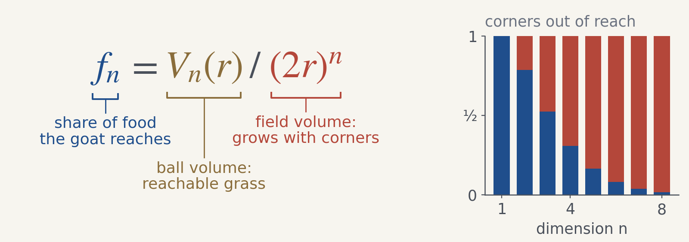
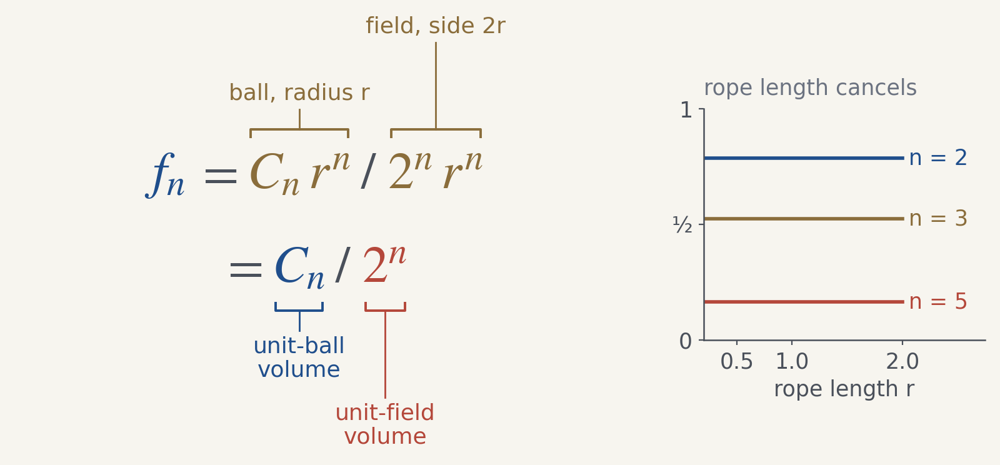
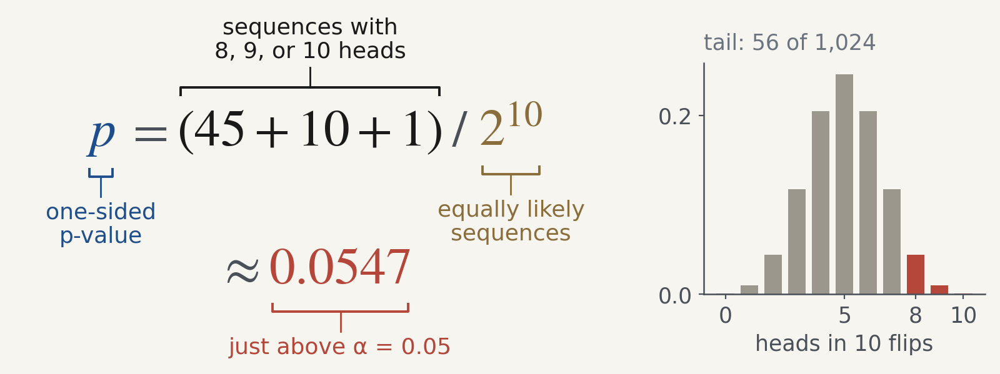
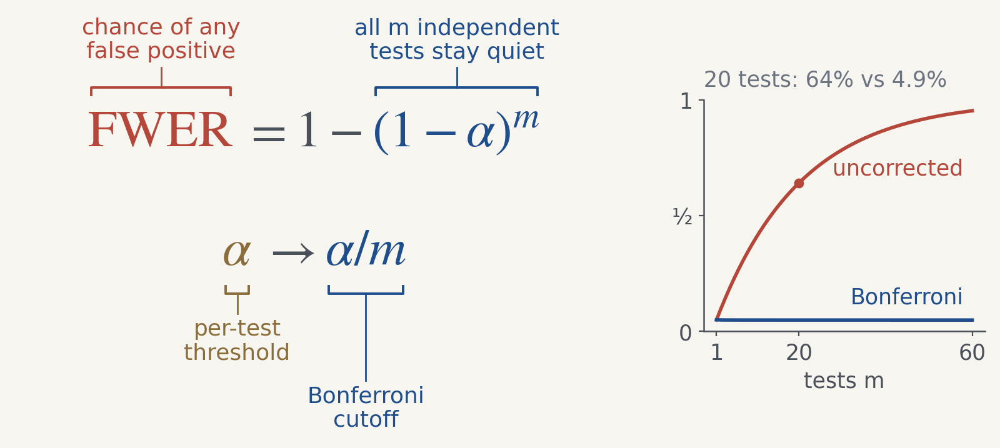

# AnnotatedEquations

**An agent skill for explaining equations visually.** Built by Bennett Landman while writing the ES 1400 engineering course book.

A goat is tied to the center of a square field. Its rope reaches the midpoint of each side. Now imagine the same problem in more dimensions. What fraction of the grass can it reach?

Here is the equation as ordinary typesetting:

And here is the teaching figure:

*The food share is a ratio of two volumes, and an increasing fraction of the field lies outside the ball as dimension grows.*

The labels answer “what are we dividing?” The inset answers “what happens as we add dimensions?” The equation is unchanged. The reader now has a route through it.

[See six worked teaching cases, with plain equations, annotations, assumptions, and phone/dark variants.](docs/book-examples.md)

## Why I created this

I developed this while turning ES 1400 material into a book that someone could read without hearing me explain it. On a page, the equation has to carry more of that explanation: which pieces belong together, what they mean in the problem, and what the reader should notice.

The goat problem made the need concrete. One figure has to explain a ratio of volumes. The next has to explain why rope length cancels. Later, a zero in a limit needs a warning: every finite-dimensional goat still reaches some grass. The symbols alone do not tell a layout engine which of those ideas I am trying to teach.

I initially considered a standalone web editor. The question that changed the design was: **who chooses which parts get labels?** Those choices depend on the audience and the point of the explanation. I wanted to share the agent's approach to those choices together with the renderer that makes the figures consistent. That is why this is a skill.

## A cancellation should explain what stays fixed

*When the ball radius is r and the field side is 2r, scaling both together leaves the reachable fraction unchanged.*

The grouping changes with the question. Here, labeling the two complete volumes makes the cancellation meaningful. The inset is flat because both the ball and the field scale together. Lengthening a rope in a field of fixed size would be a different model.

## A p-value should show which outcomes were counted

*The tail holds 56 of 1,024 sequences, so eight heads is not quite surprising enough at α = 0.05.*

The numerator gets one bracket because it represents one idea: results at least as extreme as the observation. The inset makes “at least” visible by highlighting eight, nine, **and** ten heads. This is a planned, one-sided test of ten independent fair-coin flips; it is not the probability that the coin is fair.

## A threshold should show what repeated testing changes

*Twenty independent tests at α = 0.05 give about a 64% chance of at least one false positive; Bonferroni brings it to about 4.9% in this model.*

Labeling the whole complement term explains how to read the formula. Plotting it shows why the distinction between a per-test threshold and a family-wide probability matters. These curves assume independent, exactly calibrated tests of true null hypotheses. Bonferroni's general error bound does not require independence.

## Try it with your own equation

After [installing the skill](docs/install.md), ask an agent:

> Use $annotated-equations to explain this equation for first-year engineering students. Here are the symbol definitions and assumptions. Show the relationship that makes the result surprising. Export wide and phone layouts, with editable source and a caption.

Or discuss style first:

> Use $annotated-equations. Let's discuss the palette and label style before rendering. These figures will go on white-background slides. Can we compare teal/orange with monochrome?

Then revise the explanation conversationally:

> Keep the numerator under one bracket: those outcomes form a single tail. Make the caption explain why nine and ten heads are included.

The skill accepts colors, fonts, backgrounds, label tone, density, bracket placement, and inset preferences. The blue/salmon/brown book palette is a default. It is not a restriction.

## What you get

The package contains the agent instructions, Python renderer, editable example specifications, and reproducible figure generators. Each requested wide/narrow and light/dark variant exports as SVG and PNG, with separate caption/alt text and a geometry report. A compatible agent needs file access, Python execution, and image viewing for visual review. Rendering needs Python 3.9+ and Matplotlib; it does not need an API key or a course checkout.

- [Install, update, or remove the skill](docs/install.md)
- [Use it, revise a figure, or reproduce the examples](docs/use.md)
- [Six book examples and the reasoning behind their annotations](docs/book-examples.md)
- [Color and style options](skills/annotated-equations/references/style.md)
- [Editable inputs and rendering API](skills/annotated-equations/references/rendering.md)
- [Source figure IDs and provenance](skills/annotated-equations/examples/book/provenance.json)

Passing a layout check does not establish mathematical correctness or guarantee that a figure explains the intended idea. The agent must inspect the actual outputs and keep the mathematics, assumptions, caption, and inset consistent.

Copyright © 2026 Bennett Landman. All rights reserved. See [NOTICE.md](NOTICE.md).
