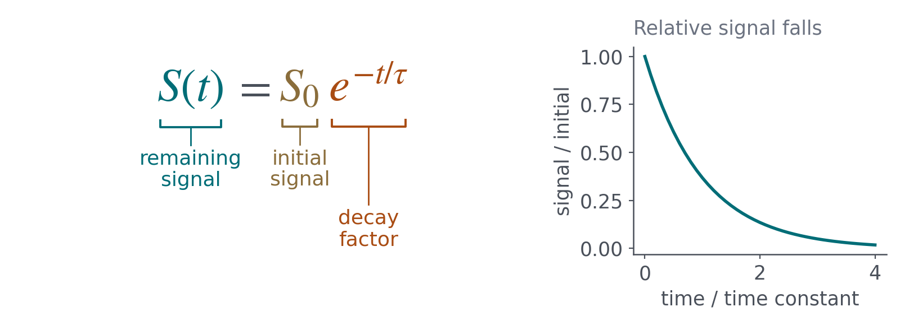

# AnnotatedEquations

An agent skill for turning equations into teaching figures: meaningful groups, plain-language bracket labels, coordinated colors, optional behavior insets, and a concise takeaway. Adapted from Bennett Landman's ES 1400 equation system.

The agent chooses what to explain and reviews the result. Bundled Python code measures and renders the layout. No course checkout, hosted service, API key, or external LaTeX installation is required. A compatible agent needs file access, Python execution, and image viewing for visual verification.



## Install

This repository is private. Authenticate to GitHub as an authorized collaborator first. Clone it into a location you control:

```sh
gh repo clone BennettLandman/AnnotatedEquations
cd AnnotatedEquations
```

For Codex, copy the complete skill folder into your user skills directory (use your configured skills location if different):

```sh
mkdir -p ~/.codex/skills
cp -R skills/annotated-equations ~/.codex/skills/
```

If that destination already exists, review or back it up before replacing it. Start a new chat/session so the skill can be discovered. The skill name is `annotated-equations`. Other agents that support folder-based Agent Skills can use the same folder in their own configured skill location; invocation and discovery depend on the host.

Install rendering dependencies into a virtual environment. For a copied Codex installation:

```sh
python3 -m venv ~/.codex/skills/annotated-equations/.venv
~/.codex/skills/annotated-equations/.venv/bin/python -m pip install -r ~/.codex/skills/annotated-equations/requirements.txt
```

Use that environment's Python when rendering. Python 3.9+ is required; Matplotlib supplies the default fonts. The `.venv` is local and should not be committed or shared as part of the skill.

## Use with an agent

Invoke it explicitly, or ask for an annotated equation figure:

> Use $annotated-equations to explain A = πr² for first-year engineering students. Emphasize what happens when rope length doubles. Export wide and narrow SVGs and PNGs.

You can discuss design before generating anything:

> Use $annotated-equations. Let's discuss color options first. This is for white-background slides; I prefer teal and orange. Keep labels conversational and use the attached style guide.

You can also request monochrome, brand colors, dark backgrounds, different fonts, compact or spacious labels, labels above the equation, or no inset. Defaults are suggestions, not restrictions. The skill should honor established preferences without asking the same questions on every figure.

Revise conversationally:

> Group the entire exponential under one bracket. Explain the time constant in the prose. Make the labels more appropriate for graduate students.

Provide the equation plus audience and teaching goal when you can. Include symbol definitions, units, assumptions, and a source for specialized notation. If the equation is ambiguous, the agent should clarify rather than silently change the mathematics.

## Run the renderer directly

From this repository:

```sh
python3 -m venv .venv
.venv/bin/python -m pip install -r skills/annotated-equations/requirements.txt
.venv/bin/python skills/annotated-equations/scripts/render_equation.py skills/annotated-equations/examples/area.json --output output/area
.venv/bin/python skills/annotated-equations/scripts/render_equation.py skills/annotated-equations/examples/decay.json --output output/decay
```

Each example produces wide/narrow × light/dark SVGs and opaque PNGs, the editable JSON, caption/alt text, and geometry checks. SVGs have transparent backgrounds. A check failure returns exit code 1 after writing outputs for diagnosis; invalid input returns 2. Passing checks still requires visual and mathematical review.

See [rendering instructions](skills/annotated-equations/references/rendering.md) for the input format and custom inset API, and [style guidance](skills/annotated-equations/references/style.md) for palettes and other options. The JSON format intentionally leaves semantic decisions to the agent or author.

## Update and verify

Pull repository updates, then review and replace the installed skill folder (preserve any local changes and recreate dependencies if needed). Installation is a copy, so pulling does not automatically update that copy.

```sh
git pull --ff-only
.venv/bin/python -m unittest discover -s tests -v
```

Tests cover invalid input, output artifacts, geometry checks, and custom colors. They do not establish that annotations explain the intended science. Open all exported variants at their intended final sizes before use. Editable JSON and external captions retain information that outlined SVG glyphs cannot provide to screen readers.

Copyright © 2026 Bennett Landman. All rights reserved. See [NOTICE.md](NOTICE.md).
