# Six teaching decisions from the book

These cases come from Chapter 01 of Bennett Landman's ES 1400 course book. They show the same notation with and without the teaching layer. The plain versions preserve the equation rows and remove the labels, role colors, and insets. They are comparison baselines, not claims about what the book used to look like.

The examples are bundled with editable term specifications and a standalone generator. They preserve the source mathematics and inset models; some labels and positions have been adapted for this renderer. [Exact source commit and figure IDs](../skills/annotated-equations/examples/book/provenance.json) · [Reproduction commands](use.md#reproduce-the-bundled-examples).

## 1. What fraction of the field is within reach?

**Ask the agent:** “Explain the fraction the goat reaches. Distinguish the reachable grass from the whole field, then show what happens as dimension grows.”

A bracket under each individual symbol would miss the important grouping. The numerator is one reachable volume; the denominator is one total volume. Labels attach the geometry to those complete expressions. The stacked bars partition the total share into reachable and unreachable regions, so the reader sees what the ratio measures.

**Model:** an n-dimensional cube of side 2r, an n-dimensional ball of radius r centered in it, r > 0, and uniformly distributed grass. The plot changes n while comparing fractions. “Corners” is geometric shorthand for the portion of the cube outside the ball, not just its vertices.

**Decision to carry to another problem:** when teaching a normalized quantity, label what is being measured and what it is measured relative to. A ratio is not just two symbol lists.

**Plain equation**

**Annotated explanation**

*The food share is a ratio of two volumes, and the field’s corners grow faster than the ball.*

Phone layout, dark theme, and editable source

The phone image is shown at the default minimum display width of 286 CSS pixels. The plot moves below the equation. Labels remain part of the explanation rather than shrinking to fit beside the plot.

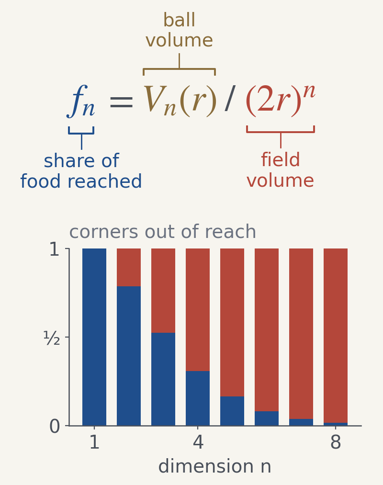

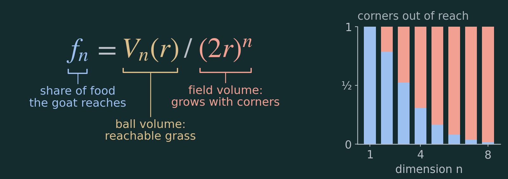

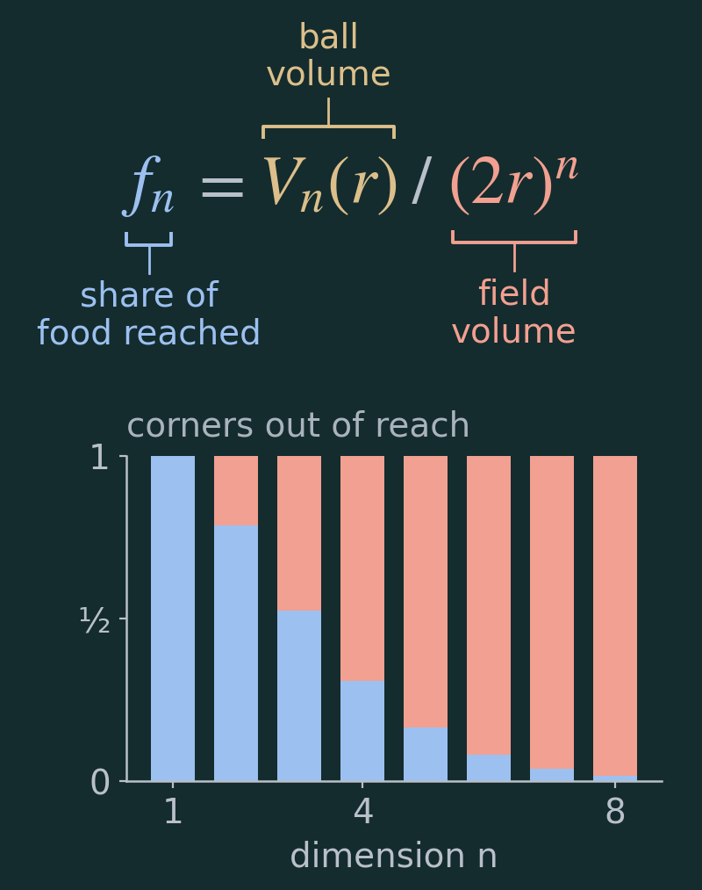

[Wide SVG](../skills/annotated-equations/examples/book/figures/fraction-wide-light.svg) · [Narrow SVG](../skills/annotated-equations/examples/book/figures/fraction-narrow-light.svg) · [Dark SVG](../skills/annotated-equations/examples/book/figures/fraction-wide-dark.svg) · [Dark narrow SVG](../skills/annotated-equations/examples/book/figures/fraction-narrow-dark.svg)

Editable source: `GOAT-EQ03` in [equations.json](../skills/annotated-equations/examples/book/equations.json). Generator: [build_examples.py](../skills/annotated-equations/examples/book/build_examples.py).

## 2. Why does rope length cancel?

**Ask the agent:** “Use the same goat problem to explain scale invariance. Show what changes when both the rope and field are scaled.”

The figure begins with the same ratio as the previous case, but the job has changed. Whole-volume labels identify the two objects being scaled. The second row exposes the common rⁿ factor's cancellation. The plot now varies r at fixed n, so the lines are flat.

**Model:** field side remains 2r while rope length is r. The comparison scales both objects together. If the field were held fixed while the rope grew, these flat curves would be misleading.

**Decision to carry to another problem:** changing the teaching question can require different grouping and a different inset for algebraically equivalent formulas. “Make the equation prettier” does not specify that choice.

**Plain equation**

**Annotated explanation**

*The rope length cancels, so only the dimension decides the goat’s share.*

Phone layout, dark theme, and editable source

The phone image is shown at the default minimum display width of 286 CSS pixels. The plot moves below the equation. Labels remain part of the explanation rather than shrinking to fit beside the plot.

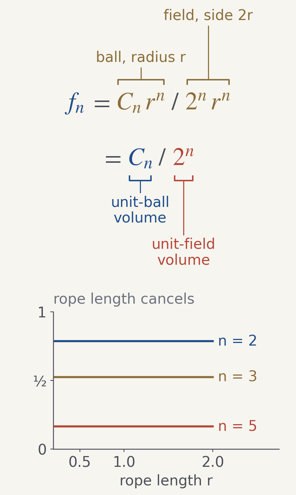

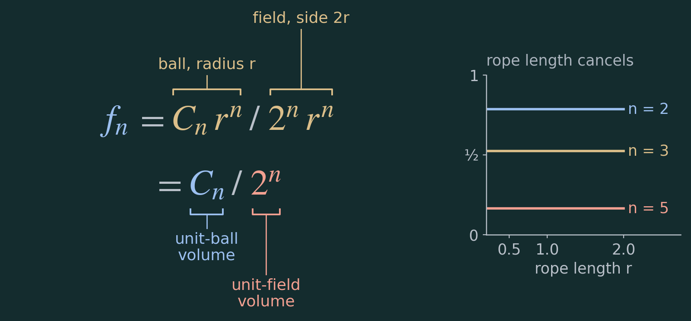

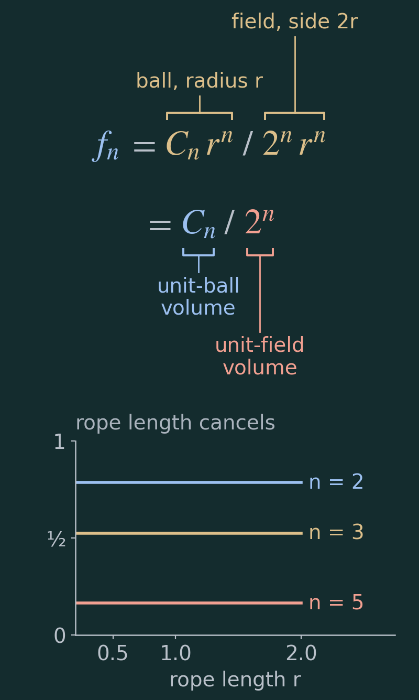

[Wide SVG](../skills/annotated-equations/examples/book/figures/cancel-wide-light.svg) · [Narrow SVG](../skills/annotated-equations/examples/book/figures/cancel-narrow-light.svg) · [Dark SVG](../skills/annotated-equations/examples/book/figures/cancel-wide-dark.svg) · [Dark narrow SVG](../skills/annotated-equations/examples/book/figures/cancel-narrow-dark.svg)

Editable source: `GOAT-EQ04` in [equations.json](../skills/annotated-equations/examples/book/equations.json). Generator: [build_examples.py](../skills/annotated-equations/examples/book/build_examples.py).

## 3. Which part makes the sequence shrink?

**Ask the agent:** “Explain why adding two dimensions reduces the reachable fraction by more than half once n ≥ 2.”

The current and next shares stay blue. The multiplier gets the contrasting color and the label “at most π/8 when n ≥ 2.” The bars and reference line turn that bound into a visual comparison. Since π/8 is about 0.393, it is below one half.

**Model:** the same centered ball/cube geometry, with integer n ≥ 2. The recurrence compares n with n + 2; it does not compare adjacent dimensions. The bound is attained at n = 2.

**Decision to carry to another problem:** a complicated-looking factor may be best labeled as a single multiplier. Here the reader needs its upper bound, rather than a separate annotation for π, 2, and n + 2.

**Plain equation**

**Annotated explanation**

*Because π/8 is less than ½, adding two dimensions at least halves the share once n ≥ 2.*

Phone layout, dark theme, and editable source

The phone image is shown at the default minimum display width of 286 CSS pixels. The plot moves below the equation. Labels remain part of the explanation rather than shrinking to fit beside the plot.

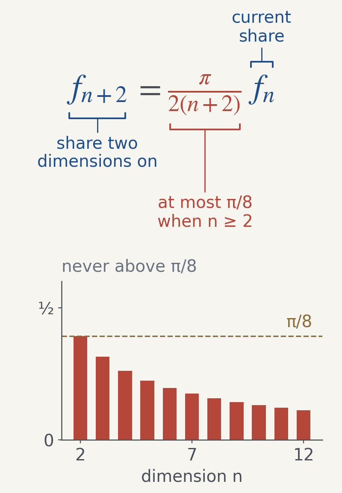

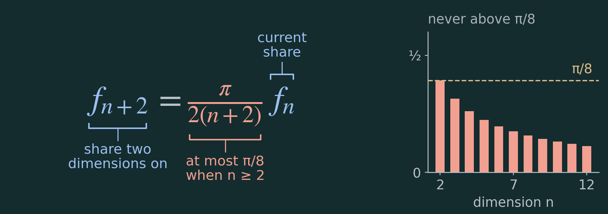

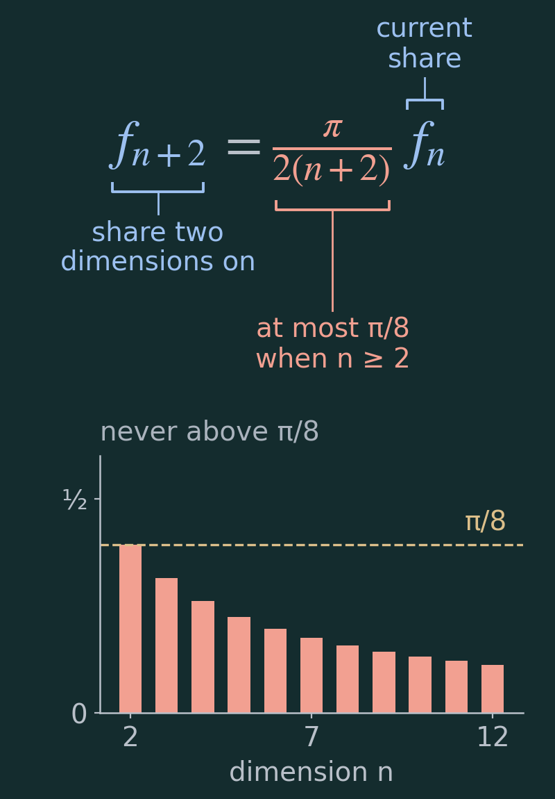

[Wide SVG](../skills/annotated-equations/examples/book/figures/step-two-wide-light.svg) · [Narrow SVG](../skills/annotated-equations/examples/book/figures/step-two-narrow-light.svg) · [Dark SVG](../skills/annotated-equations/examples/book/figures/step-two-wide-dark.svg) · [Dark narrow SVG](../skills/annotated-equations/examples/book/figures/step-two-narrow-dark.svg)

Editable source: `GOAT-EQ20` in [equations.json](../skills/annotated-equations/examples/book/equations.json). Generator: [build_examples.py](../skills/annotated-equations/examples/book/build_examples.py).

## 4. Does a limit of zero mean the goat eats nothing?

**Ask the agent:** “Explain the conclusion without implying that some finite-dimensional goat reaches exactly zero grass.”

The zero is the term most likely to be overread, so its label states the distinction: “limit only: each fₙ > 0.” The limit operator gets an ordinary-language description, while fₙ is identified as the reachable share. There is no inset: the preceding recurrence provides the behavior, and this figure's job is to explain the limiting statement.

**Model:** fₙ is a positive fraction at every finite positive integer n. Its limit as n grows is zero. This is a statement about arbitrarily small fractions, not a physical goat living in an infinite-dimensional field.

**Decision to carry to another problem:** annotate the likely misinterpretation, even when the symbol itself is familiar. Add an inset only when it does a useful job.

**Plain equation**

**Annotated explanation**

*The share gets as small as you like, even though every finite-dimensional goat still eats something.*

Phone layout, dark theme, and editable source

The phone image is shown at the default minimum display width of 286 CSS pixels. The plot moves below the equation. Labels remain part of the explanation rather than shrinking to fit beside the plot.

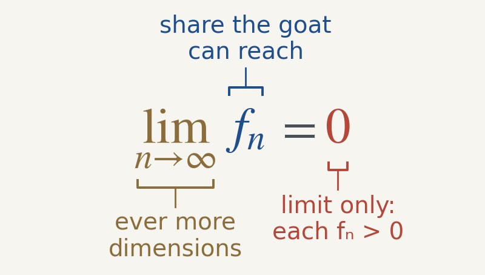

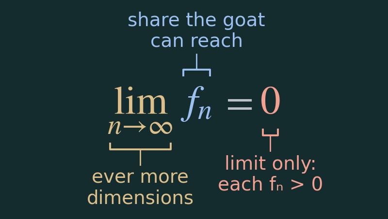

[Wide SVG](../skills/annotated-equations/examples/book/figures/limit-wide-light.svg) · [Narrow SVG](../skills/annotated-equations/examples/book/figures/limit-narrow-light.svg) · [Dark SVG](../skills/annotated-equations/examples/book/figures/limit-wide-dark.svg) · [Dark narrow SVG](../skills/annotated-equations/examples/book/figures/limit-narrow-dark.svg)

Editable source: `GOAT-EQ23` in [equations.json](../skills/annotated-equations/examples/book/equations.json). Generator: [build_examples.py](../skills/annotated-equations/examples/book/build_examples.py).

## 5. Why count nine and ten heads when we observed eight?

**Ask the agent:** “Explain the one-sided p-value for eight heads in ten planned flips of a fair coin.”

The numerator's three counts stay under one bracket because together they are the tail event. The denominator counts all 1,024 ordered sequences, not the eleven possible head counts. The inset makes the distinction visible: eight, nine, and ten heads are highlighted; the bars have different probabilities.

**Model:** ten independent flips, fair-coin null, fixed sample size, and the alternative “more heads” selected before seeing the outcome. The tail count is C(10,8) + C(10,9) + C(10,10) = 45 + 10 + 1 = 56. The exact p-value is 56/1,024 = 0.0546875, so this planned test does not reject at 0.05. That does not prove the coin fair.

**Decision to carry to another problem:** group terms by the event they count. The inset should expose why those outcomes belong together, rather than simply repeat the numerical answer.

Primary reference: [NIST/SEMATECH, binomial distribution](https://www.itl.nist.gov/div898/handbook/eda/section3/eda366i.htm).

**Plain equation**

**Annotated explanation**

*The tail holds 56 of 1,024 sequences, so eight heads is not quite surprising enough at α = 0.05.*

Phone layout, dark theme, and editable source

The phone image is shown at the default minimum display width of 286 CSS pixels. The plot moves below the equation. Labels remain part of the explanation rather than shrinking to fit beside the plot.

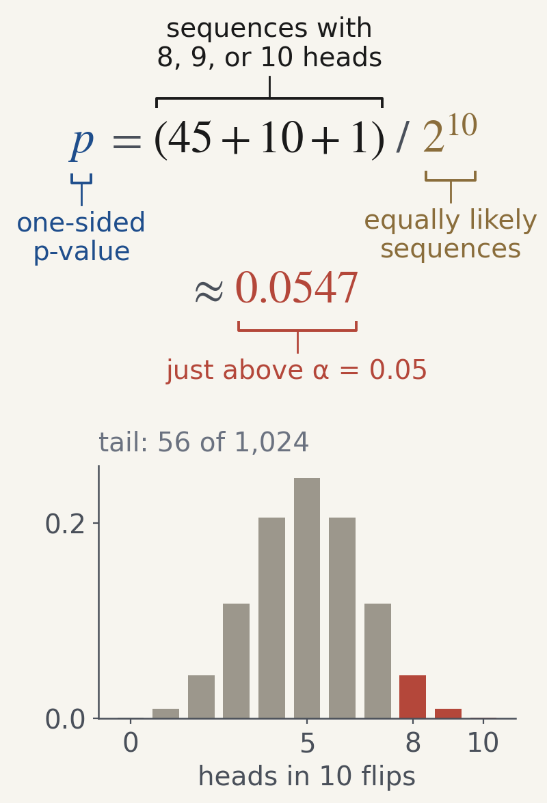

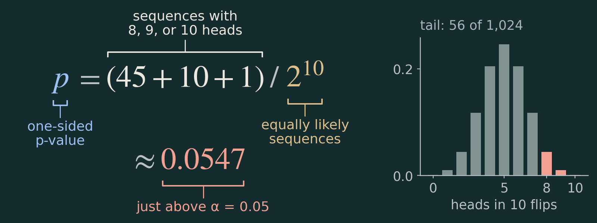

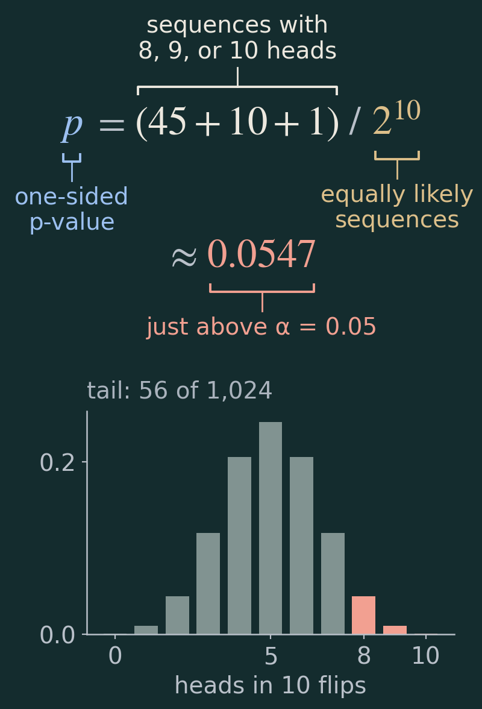

[Wide SVG](../skills/annotated-equations/examples/book/figures/pvalue-wide-light.svg) · [Narrow SVG](../skills/annotated-equations/examples/book/figures/pvalue-narrow-light.svg) · [Dark SVG](../skills/annotated-equations/examples/book/figures/pvalue-wide-dark.svg) · [Dark narrow SVG](../skills/annotated-equations/examples/book/figures/pvalue-narrow-dark.svg)

Editable source: `GOAT-EQ24` in [equations.json](../skills/annotated-equations/examples/book/equations.json). Generator: [build_examples.py](../skills/annotated-equations/examples/book/build_examples.py).

## 6. How can a 5% threshold lead to a 64% chance?

**Ask the agent:** “Explain why twenty independent tests at a per-test threshold of 0.05 have a much larger chance of at least one false positive.”

The expression (1 − α)ᵐ is labeled as a single event: all m independent tests stay quiet. Taking its complement gives at least one false positive. The second row connects a different per-test cutoff, α/m, to the corrected curve. The inset turns a distinction between two probabilities into a visible gap.

**Model:** m independent, exactly calibrated tests of true null hypotheses. For m = 20 and α = 0.05, 1 − 0.95²⁰ is about 64.15%. Using α/m gives 1 − (1 − 0.05/20)²⁰, about 4.88%, under the same independence model. The Bonferroni bound itself remains valid under dependence when the individual tests are valid; the plotted exact formula requires independence.

**Decision to carry to another problem:** probability labels should name the events. Color consistency connects each term to its curve, while direct curve labels preserve meaning without relying only on color.

**Plain equation**

**Annotated explanation**

![Annotated equations: FWER equals 1 minus 1 − alpha to the power m, and the per-test threshold alpha becomes alpha over m under Bonferroni. Salmon: the family-wise error rate, the chance of any false positive. Blue: 1 − alpha to the m, the chance that all m independent tests stay quiet, and the Bonferroni cutoff alpha over m. Brown: the per-test threshold alpha. Inset: the chance of any false positive for 1 to 60 tests; uncorrected tests at alpha = 0.05 climb to 64% at 20 tests, while Bonferroni stays just under 5%.](../skills/annotated-equations/examples/book/figures/family-wise-wide-light.png)

*Twenty independent tests at α = 0.05 give a 64% chance of at least one false positive; Bonferroni brings it back to 4.9%.*

Phone layout, dark theme, and editable source

The phone image is shown at the default minimum display width of 286 CSS pixels. The plot moves below the equation. Labels remain part of the explanation rather than shrinking to fit beside the plot.

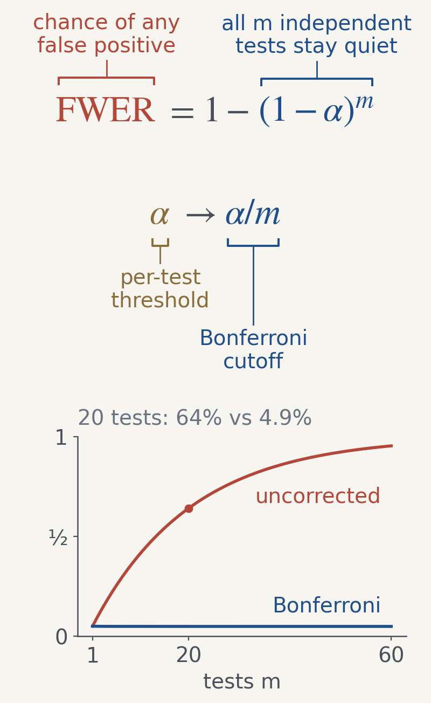

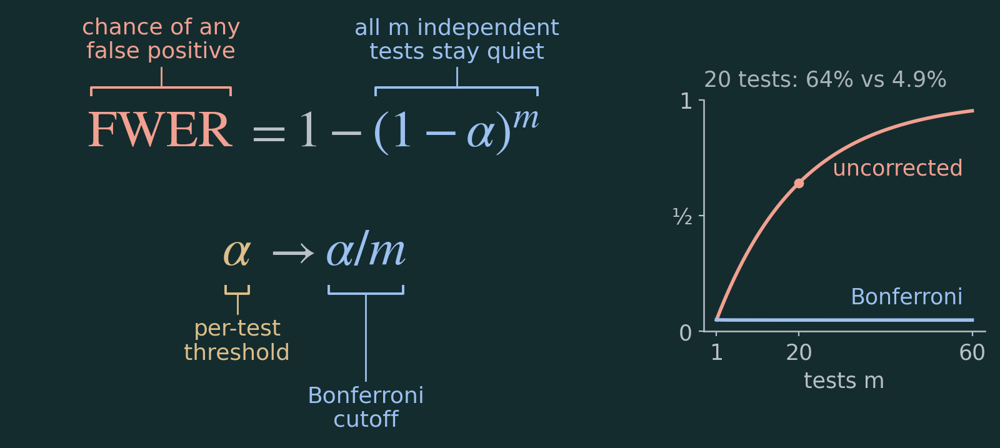

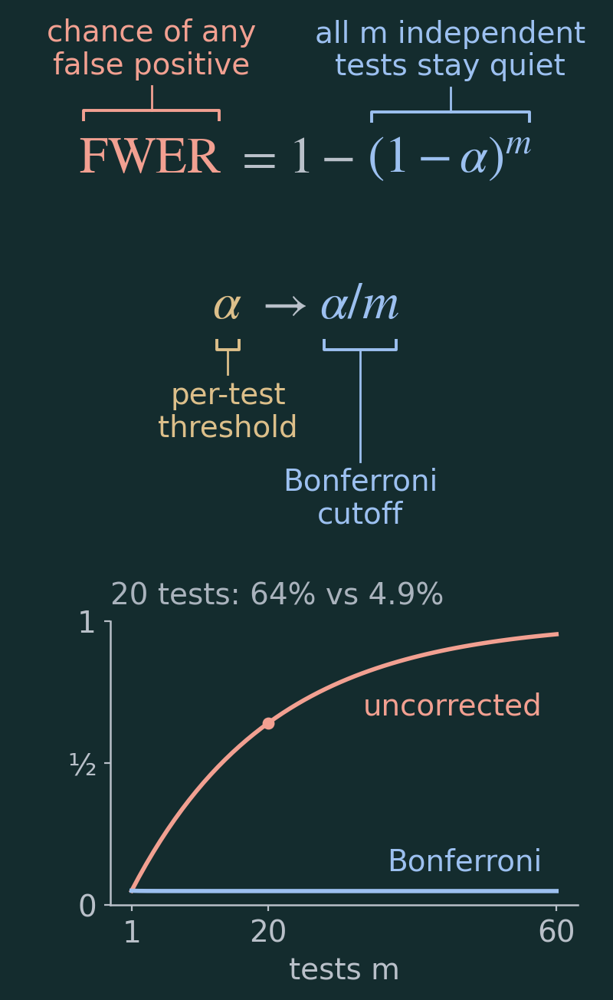

[Wide SVG](../skills/annotated-equations/examples/book/figures/family-wise-wide-light.svg) · [Narrow SVG](../skills/annotated-equations/examples/book/figures/family-wise-narrow-light.svg) · [Dark SVG](../skills/annotated-equations/examples/book/figures/family-wise-wide-dark.svg) · [Dark narrow SVG](../skills/annotated-equations/examples/book/figures/family-wise-narrow-dark.svg)

Editable source: `GOAT-EQ25` in [equations.json](../skills/annotated-equations/examples/book/equations.json). Generator: [build_examples.py](../skills/annotated-equations/examples/book/build_examples.py).

## What changes between the examples?

| Teaching question | Group that earns a bracket | What the inset contributes |
| --- | --- | --- |
| What fraction is reachable? | Complete ball and field volumes | Part of a whole as dimension changes |
| Why does rope length cancel? | Each scaled volume, then the remaining constants | Flat fractions when both objects scale |
| Why does the sequence shrink? | The whole recurrence multiplier | Its bound relative to one half |
| What does the limit say? | The limit operator, the share, and the limiting zero | None needed for this explanation |
| Why count more than the observed outcome? | All three tail counts together | The exact highlighted tail event |
| What does repeated testing change? | The all-tests-quiet probability | Per-test and family-wide probabilities diverge |

Those are the decisions the agent makes from context. The renderer then measures the chosen terms and labels, places brackets, handles variants, and reports selected geometric problems. [Use the same process for your equation.](use.md)
